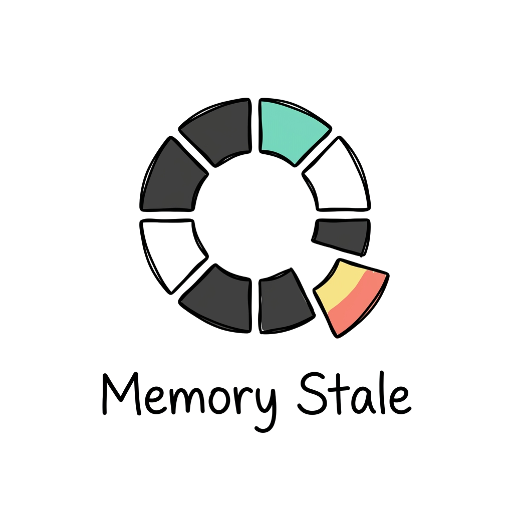
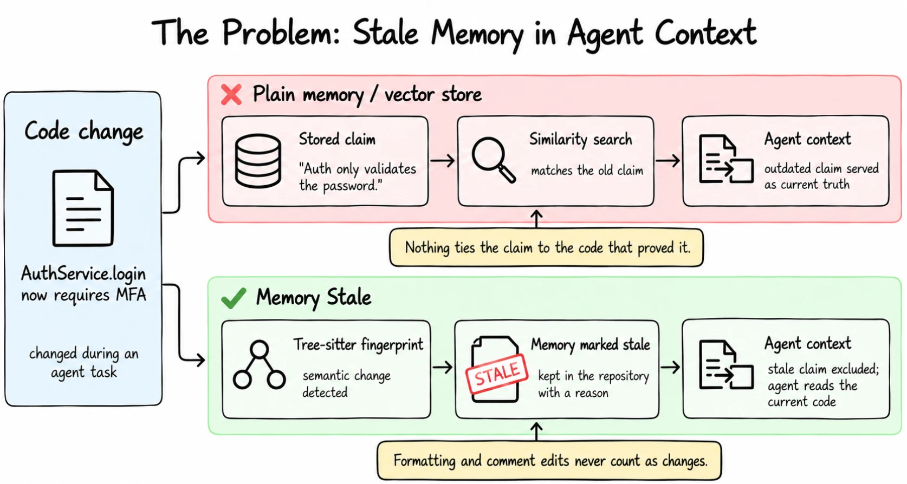
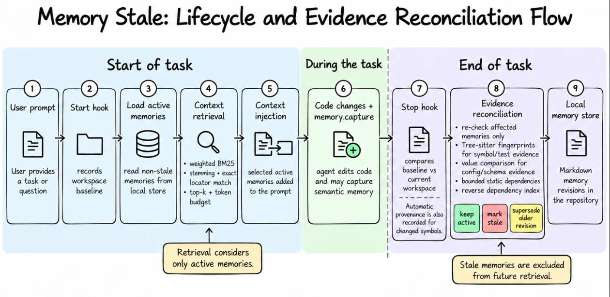

<p align="center">
  <picture>
    <source media="(prefers-color-scheme: dark)" srcset="./assets/logo-dark.png">
    
  </picture>
</p>

<h3 align="center">Project memory for coding agents that expires when the code changes.</h3>

<p align="center">
  <a href="LICENSE.txt"></a>
  
  
  <a href="#evaluation"></a>
</p>

---

Memory Stale gives **Claude Code**, **Codex**, and **Antigravity** a persistent,
project-local memory where every fact is tied to the code that proves it. When
that code changes in a way that matters, the memory is marked **stale** and
stops being injected into your agent's context. Reformatting and comment edits
don't count as changes.

- **No stale "facts" in your prompts.** Evidence is fingerprinted from the
  Tree-sitter syntax tree, not from raw text.
- **Nothing leaves your machine.** No embeddings, no vector database, no extra
  LLM calls, no cloud service.
- **Reviewable like code.** Memories are plain Markdown files in your
  repository, so you can diff them, review them in pull requests, and branch
  them.
- **Zero new workflow.** It runs inside your agent's normal lifecycle hooks.

```text
Task 1  Agent records: "AuthService.login validates only the password."
        Evidence: src/auth.py:AuthService.login

Task 2  You add multi-factor authentication to AuthService.login.

Task 3  Agent works on authentication again.
        Plain memory:  injects the password-only claim as current truth.
        Memory Stale:  detects the semantic change, marks the memory stale,
                       and keeps it out of the prompt.
```

<p align="center">
  
</p>

## Contents

- [Quickstart](#quickstart)
- [How it works](#how-it-works)
- [Everyday use](#everyday-use)
- [Evidence types](#evidence-types)
- [Configuration](#configuration)
- [What gets stored](#what-gets-stored)
- [Supported languages](#supported-languages)
- [Guarantees and limitations](#guarantees-and-limitations)
- [Evaluation](#evaluation)
- [Comparison with other approaches](#comparison-with-other-approaches)
- [Contributing](#contributing)
- [License](#license)

## Quickstart

**Requirements:** a Git repository, [`uv`](https://docs.astral.sh/uv/), and
Python 3.10 or newer on your `PATH`.

1. Clone Memory Stale anywhere outside your project:

   ```bash
   git clone https://github.com/fagnermourafeitosa/memory-stale.git ~/memory-stale
   ```

2. Install it into your project for the harness you use:

   ```bash
   sh ~/memory-stale/scripts/install-project.sh /path/to/your/project --harness claude
   ```

   Use `--harness codex` or `--harness antigravity` for the other agents.

3. Restart your agent, or open a new session, so it loads the hooks and the
   local MCP server.

That's it. The first prompt prepares the runtime environment automatically with
`uv`.

<details>
<summary>What the installer writes</summary>

| Harness | Files |
| :--- | :--- |
| All | `.agents/skills/memory-stale/` (runtime), `.agents/skills/.agent-memory/config.toml` (defaults, written only if missing) |
| Claude Code | `.claude/settings.json` (hooks), `.claude/skills/memory-stale/SKILL.md`, `.mcp.json` |
| Codex | `.codex/hooks.json`, `.mcp.json` |
| Antigravity | `.agents/hooks.json`, `.agents/plugins/memory-stale/` |

The installer merges into existing configuration and refuses to overwrite an
incompatible `memory-stale` MCP entry. To upgrade, delete
`.agents/skills/memory-stale/` and run the installer again. Your memories and
configuration are kept.

</details>

## How it works

<p align="center">
  
</p>

1. **Prompt submitted.** Memory Stale records a baseline of your working tree
   and injects the most relevant **active** memories into the agent's context.
2. **Agent works.** When it completes a meaningful change, the agent calls the
   `memory.capture` MCP tool with a claim and the evidence that supports it. The
   bundled skill teaches it when and how to do this.
3. **Turn ends.** Memory Stale compares the working tree with the baseline:
   - It stores the captured memories.
   - It records automatic provenance for changed symbols.
   - It re-checks every memory whose evidence lives in a changed file. Each one
     is either kept active or marked stale with a reason.

Memories don't depend only on the lines you name. For symbol evidence, Memory
Stale also follows direct calls and named reads, up to 3 hops. If a helper your
claim relies on changes, the claim goes stale too, and the stale reason shows
the path:

```text
claim
  → supported_by src/jobs.py:retry
      → calls src/policy.py:max_retries      ← changed
```

```text
stale reason: changed via symbol:src/jobs.py:retry -[calls]-> symbol:src/policy.py:max_retries
```

Retrieval is lexical and deterministic. It uses field-weighted BM25 with
stemming over the claim, the durability reason, optional retrieval terms, and
exact code locators. Only the top-ranked active memories that fit your token
budget are injected.

## Everyday use

You keep working as usual. Memory Stale adds three things your agent can do on
request:

| Ask your agent for… | What happens |
| :--- | :--- |
| Nothing (automatic) | Relevant active memories are injected on every prompt. New knowledge is captured as the agent completes changes. |
| `/memory-stale dream` | An audit of every active memory against the current code. The agent reviews what went stale or broke and re-captures facts that still hold. |
| "the Memory Stale health report" | A standalone `memory-report.html` listing every memory, its evidence, its status, and why it is stale. |

**Statuses:**

- `active`: every piece of recorded evidence still matches.
- `stale`: some evidence changed semantically, disappeared, or can no longer be
  resolved. The stale reason says which.
- `superseded`: the claim was captured again with newer evidence.

An `active` memory is not proof that the claim is true, and a `stale` memory is
not proof that it is false. Status only says whether the evidence still
matches.

A capture request looks like this:

```json
{
  "kind": "behavior",
  "claim": "Failed jobs retry up to 3 times before surfacing an error.",
  "durability_reason": "Worker services depend on this retry contract.",
  "evidence": [
    { "type": "symbol", "role": "primary", "locator": "src/jobs.py:retry" },
    { "type": "test", "role": "supporting", "locator": "tests/test_jobs.py:test_retry_limit" }
  ],
  "retrieval_terms": ["retry limit", "background job retries"]
}
```

`kind` is one of `behavior`, `contract`, `constraint`, `architecture`, or
`operation`. At least one `primary` evidence item must have changed during the
current turn. This keeps memories anchored to work the agent actually did.

## Evidence types

| Type | Locator | Becomes stale when… |
| :--- | :--- | :--- |
| `symbol` | `path:Symbol` or `path:Class.method` | the symbol's normalized syntax tree changes, or one of its static dependencies changes |
| `test` | `path:test_name` | the test's normalized syntax tree changes, or one of its static dependencies changes |
| `config` | `path#/json/pointer` in JSON, YAML, or TOML | the value at that exact node changes |
| `schema` | `path#/json/pointer` in a JSON Schema or OpenAPI document (JSON or YAML) | the value at that exact node changes |

None of these go stale on reformatting, comments, key reordering, or edits to
sibling nodes. Locators must stay inside the repository and resolve exactly;
there is no fuzzy matching.

When a stored item can no longer be resolved, the stale reason says why:

| Reason | Meaning |
| :--- | :--- |
| `changed` | The evidence still exists but means something different. |
| `locator_missing` | The file exists, but the symbol or document node is gone. |
| `file_missing` | The evidence file was deleted. |
| `unresolvable` | The evidence can no longer be parsed or resolved. |

## Configuration

Settings live in `.agents/skills/.agent-memory/config.toml`:

```toml
# Maximum number of tokens of active memory injected into task context.
context_budget = 1500

# Maximum number of highest-ranked active memories injected per task.
top_k = 5

# Repository-relative path used when an HTML report is requested.
report_path = "memory-report.html"
```

An invalid value is reported to the agent as a non-blocking hook message.

## What gets stored

Everything lives in your repository, in a format you can read without Memory
Stale:

```text
.agents/skills/.agent-memory/
├── config.toml
└── memories/
    └── 4d269f796c036c55e80f.md     # one file per memory revision
```

Each memory is an [Open Knowledge Format (OKF) v0.2](https://github.com/GoogleCloudPlatform/knowledge-catalog/blob/main/okf/SPEC.md)
Markdown document. Memory Stale's own data lives under a `memory_stale`
extension:

```markdown
---
type: Memory Stale Claim
title: Failed jobs retry up to 3 times before surfacing an error.
description: Worker services depend on this retry contract.
sources:
  - id: symbol:src/jobs.py:retry
    resource: src/jobs.py:retry
generated:
  by: process:memory-stale
  at: '2026-08-17T01:16:59+00:00'
verified:
  - by: process:memory-stale
    at: '2026-08-17T01:16:59+00:00'
status: stable
memory_stale:
  schema_version: 5
  claim_id: a21a51563b6b770cacdc
  revision_id: 4d269f796c036c55e80f
  kind: behavior
  status: active
  evidence:
    - source_id: symbol:src/jobs.py:retry
      type: symbol
      role: primary
      fingerprint: v2:30e84aa1ccaf5b5cd4059e08ad7412d4862d8be623dc93b3d6833f97045748b5
  supported_by:
    - symbol:src/jobs.py:retry
  dependencies: []
  stale_reasons: null
---

Failed jobs retry up to 3 times before surfacing an error.
```

Commit the `memories/` directory to share knowledge with your team. Per-turn
working state stays inside `.git/` and is never committed. A complete example is
in [`examples/memory-stale-claim.md`](examples/memory-stale-claim.md).

Older memory files (schema versions 3 and 4, and the original unversioned
format) are read as-is and rewritten in the current format the next time
Memory Stale writes the store.

## Supported languages

Symbol and test evidence, automatic capture, and static dependency expansion
are available for:

**Python** · **TypeScript / TSX** · **JavaScript** · **Go** · **Rust** · **Java** · **Kotlin**

Other languages have no fallback. Edits to unsupported files produce no
automatic records, and symbol evidence pointing at them is rejected. Memory
Stale never claims more certainty than it has. You can still anchor memories to
configuration and schema files of any project.

## Guarantees and limitations

**What Memory Stale guarantees:**

- **Hooks never block your agent.** Outside a Git repository, Memory Stale goes
  inactive. Malformed hook input or an internal error produces one short
  message, and your agent keeps working.
- **One broken memory file doesn't take the others down.** A memory file that
  can't be parsed is skipped and left untouched. It is reported at prompt time,
  in `dream`, and in the health report.
- **A file it can't read doesn't invalidate anything.** `dream` reports the
  read error and keeps the memory's status.
- **Hook cost stays predictable.** Each hook makes at most 5 Git calls, whatever
  the repository size, and parses each supported file at most once. The
  turn-end hook re-checks only memories whose evidence lives in changed files.
  On a 149-file repository (Apple Silicon, warm cache), the prompt hook took
  ≈ 1.1 s and the turn-end hook ≈ 75 ms.

**What it doesn't do:**

- **Retrieval is lexical.** A question that shares no vocabulary with the
  claim, its retrieval terms, or its code locators won't retrieve it.
- **Static analysis is bounded.** Dependencies are followed up to 3 hops and
  64 nodes, through direct calls and named reads only. Reflection, monkey
  patching, and runtime configuration are left out rather than guessed.
- **Stale memories are excluded, never rewritten.** Revalidating a stale claim
  means the agent captures it again with fresh evidence.
- **Memory Stale's own files are not evidence.** Anything under `.agents/` is ignored for capture and staleness.
- **Hand-edited internal state is not supported.** Don't edit the per-turn
  state under `.git/memory-stale/`.

## Evaluation

Memory Stale is measured against a versioned corpus of **100 human-labeled,
end-to-end repository cases**: 50 semantic changes and 50 behavior-preserving
edits.

| Metric | Result | 95% CI |
| :--- | :---: | :---: |
| Overall accuracy | **86.0%** (86/100) | 77.9% – 91.5% |
| Stale precision | **84.6%** (44/52) | 72.5% – 92.0% |
| Stale recall | **88.0%** (44/50) | 76.2% – 94.4% |
| Specificity (correctly kept active) | **84.0%** (42/50) | 71.5% – 91.7% |
| Retrieval recall | **80.0%** (32/40) | 65.2% – 89.5% |
| Stale exclusion from context | **83.3%** (50/60) | 72.0% – 90.7% |
| Mean reciprocal rank | **0.450** | — |
| NDCG@5 | **0.540** | — |
| Operational failures | **0 / 100** | — |

Reproduce it from a clone:

```bash
uv run pytest -m repository_evaluation
```

## Comparison with other approaches

| | Vector / LLM memory | Code knowledge graphs | Memory Stale |
| :--- | :--- | :--- | :--- |
| **Best at** | Fuzzy search over chats and docs | Navigating a whole codebase | Durable decisions and contracts tied to code |
| **When code changes** | Old memories stay active | Files are re-indexed on any byte change | Only semantic changes invalidate, at symbol or node level |
| **Downstream changes** | Not tracked | Tracked for navigation | Invalidate dependent memories, with the propagation path |
| **Runtime** | Embedding calls on every prompt | Batch indexing | Local, deterministic hooks |
| **Storage** | External database | Generated artifacts | Markdown in your Git repository |

They complement each other. Use semantic search for open-ended recall, a code
graph for exploration, and Memory Stale for the facts your agent must never get
wrong about the current code.

Memory Stale's invalidation model borrows the idea of coeffects and change
propagation from
[*A Programming Paradigm for Spatiotemporal Composability*](https://github.com/cordiverse/paper/blob/main/paper.pdf).
It applies only to static provenance; Memory Stale never executes or hot-swaps
your code.

## Contributing

Contributions are welcome. Read [`AGENTS.md`](AGENTS.md) first. Every
code change starts with a numbered spec in [`specs/`](specs/), and all
behavior changes are test-driven.

```bash
git clone https://github.com/fagnermourafeitosa/memory-stale.git
cd memory-stale
uv sync

uv run ruff format --check .
uv run ruff check .
uv run mypy src tests
uv run pytest
```

Please open an issue before starting large changes, so the scope can be agreed
in a spec.

## License

Memory Stale is released under the [MIT License](LICENSE.txt).
Copyright © 2026 Fagner Moura Feitosa.
